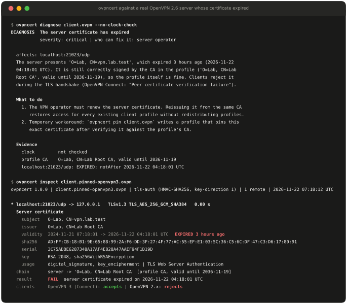
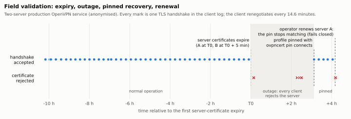
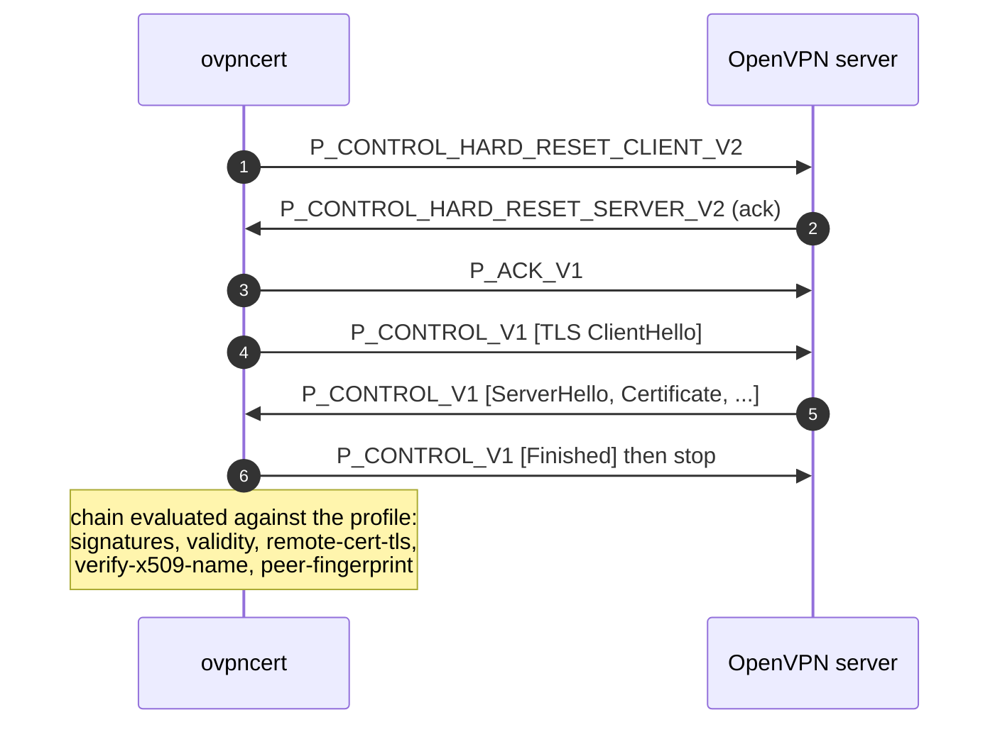

<h1 align="center">OpenVPN Certificate Inspector</h1>

<p align="center">
  <b>Read, verify and monitor the X.509 certificate of an OpenVPN server through a handshake-only probe.</b><br>
  No credentials sent. UDP and TCP. <code>tls-auth</code> and <code>tls-crypt</code>. Validated against real OpenVPN 2.6 and OpenVPN 3 clients.
</p>

<p align="center">
  <a href="https://github.com/Mhrnqaruni/openvpn-cert-inspector/actions/workflows/ci.yml"></a>
  <a href="https://github.com/Mhrnqaruni/openvpn-cert-inspector/releases"></a>
  
  
  <a href="LICENSE"></a>
</p>

<p align="center">
  
</p>
<p align="center"><sub>Unedited output from the CI lab against a real OpenVPN 2.6 server whose certificate had expired (<a href="results/transcripts">transcripts</a>).</sub></p>

## Overview

An OpenVPN server's certificate is invisible to the usual TLS tooling. OpenVPN
carries its TLS handshake inside its own packet format, with session ids,
acknowledgements and retransmission. Servers configured with `tls-auth` or
`tls-crypt` silently drop every packet not authenticated with the static key
from the client profile. As a result, `openssl s_client`, TLS scanners and
certificate-expiry exporters cannot read the certificate.

When that certificate expires, every client fails at once:

* OpenVPN Connect reports *"Peer certificate verification failure"*;
* OpenVPN 2.x logs *"certificate verify failed"*.

Neither message says whether the server, the CA, the user's profile or the
user's clock is at fault. Operators, for their part, have no simple remote way
to watch the expiry date.

`ovpncert` implements the client side of the OpenVPN control channel up to the
end of the TLS handshake, then stops. From the certificate chain it obtains,
it:

* **inspects** each remote: subject, issuer, validity, fingerprint, key usage,
  the verified chain, and whether OpenVPN 3 and OpenVPN 2.x clients will
  accept it;
* **diagnoses** a failure with a root cause, the party who can fix it, and next
  steps, cross-checked against an NTP clock and the client log;
* **pins** the certificate in a temporary profile for the right client family,
  when the only problem is an expired certificate verified against your CA;
* **monitors** expiry, with Nagios/Icinga exit codes, JSON or Prometheus
  output.

## Highlights

- **Handshake-only probe.** Hard reset and TLS inside `P_CONTROL_V1` over UDP
  or TCP, with no protection, `tls-auth` (any `--auth` digest and key
  direction) or `tls-crypt`. The key-method-2 message is never sent, so
  credentials never leave the machine.
- **Certificate capture that survives aborted handshakes.** TLS 1.3 chains are
  read from the completed client handshake. TLS 1.2 chains are read from
  cleartext records, so servers that demand a client certificate still reveal
  theirs.
- **Client-aware verification.** Signature trust and validity periods are
  evaluated separately, then combined the way each implementation does. The
  two disagree on `peer-fingerprint` ([details](docs/compatibility.md)). All
  22 predictions were confirmed by real clients.
- **Safe temporary recovery.** `ovpncert pin` refuses certificates that do not
  chain to your CA, writes the profile variant each client family accepts,
  and fails closed when the operator renews the certificate.
- **Validated three ways.**
  - 90 unit tests (89% line and branch coverage) on Linux, Windows and macOS with Python 3.10–3.14.
  - A CI lab with real OpenVPN 2.6 servers and clients plus the OpenVPN 3
    client: 29/29 and 22/22 cases.
  - A field validation during a production outage.
- **One dependency** (`cryptography`); everything else is the standard library.

## Quickstart

```bash
pipx install git+https://github.com/Mhrnqaruni/openvpn-cert-inspector    # or: pip install git+https://...
```

```bash
ovpncert inspect client.ovpn                      # certificate, chain, verdict and client predictions per remote
ovpncert diagnose client.ovpn --log openvpn.log   # root cause, who can fix it, next steps (clock and log checked)
ovpncert pin client.ovpn                          # temporary pinned profile for OpenVPN Connect / OpenVPN 3
ovpncert pin client.ovpn --client openvpn2        # ... or for OpenVPN 2.6+ (fingerprint-only mode)
ovpncert check client.ovpn --warning 30 --critical 7                # Nagios / Icinga plugin
ovpncert check client.ovpn --format prometheus > ovpncert.prom      # node_exporter textfile collector
```

Without a profile, give the pieces directly:

```bash
ovpncert inspect --remote vpn.example.org:1194/udp --tls-auth ta.key --key-direction 1 --auth SHA256 --ca ca.crt
```

Every command accepts `--json`. Exit codes:

| Command | 0 | 1 | 2 | 3 |
|---|---|---|---|---|
| `inspect`, `diagnose` | all certificates valid and trusted | certificate problem found | no remote answered | usage or profile error |
| `pin` | pinned profile written | refused by a safety check | no remote answered | usage or profile error |
| `check` | OK | WARNING | CRITICAL | UNKNOWN |

Monitoring output from the lab, for a server whose certificate expired three
hours earlier:

```text
OVPNCERT CRITICAL - localhost:21023/udp: server certificate expired 3.0 hours ago | 'localhost:21023/udp'=-0.12;30;7;;
```

## Results

### Lab: real servers, real clients

`lab/run_lab.py` runs in CI on every push. It starts real **OpenVPN 2.6.19**
servers and connects real **OpenVPN 2.6.19** clients and the **OpenVPN 3
core 3.11.3** test client, the core inside OpenVPN Connect 3.8.

| Group | Scenarios | Result |
|---|---|---|
| A. Probe interoperability | UDP/TCP × none / `tls-auth` (HMAC-SHA1, SHA256, SHA512, with and without key direction) / `tls-crypt`, plus wrong key and wrong direction | **10 / 10** |
| B. Diagnosis | valid, expired, not yet valid, expiring, foreign CA, missing serverAuth, intermediate chain, expired CA | **8 / 8** |
| C. Client behaviour | CA only, CA + pin, pin only, wrong pin and `ovpncert pin` output, for servers sending the leaf, leaf + root and leaf + intermediate | **22 / 22** (OpenVPN 2.6 and OpenVPN 3) |

How the two client families treat an **expired** certificate:

| Profile | Server sends | OpenVPN 2.6 | OpenVPN 3 / Connect |
|---|---|:---:|:---:|
| CA only | any | rejects | rejects |
| CA + `peer-fingerprint` | leaf, leaf + root, leaf + intermediate | rejects | **accepts** |
| `peer-fingerprint` only | leaf | **accepts** | **accepts** |
| `peer-fingerprint` only | leaf + root, or leaf + intermediate | **accepts** | rejects |

No single pinned profile works for both families, which is why `ovpncert pin`
has a `--client` option. Full tables:
[`results/lab-openvpn2.md`](results/lab-openvpn2.md),
[`results/lab-openvpn3.md`](results/lab-openvpn3.md). Source references:
[`docs/compatibility.md`](docs/compatibility.md).

### Field validation

<picture>
  <source media="(prefers-color-scheme: dark)" srcset="docs/figures/field-timeline-dark.svg">
  
</picture>

During an outage of a two-server production service (`tls-auth` with
HMAC-SHA512, OpenVPN Connect clients), the handshake probe established the
following (anonymised; [full account](docs/results.md#3-field-validation-anonymised)):

* It retrieved both certificates on the first attempt. Both had expired after
  731 days and still chained to the profile's CA, and the client clock was
  within 1.2 s of NTP. Diagnosis: `SERVER_CERT_EXPIRED`, to be fixed by the
  server operator.
* The pinned profile restored access until the operator acted, about an hour
  later.
* When the operator renewed the certificate, the pin stopped matching and
  refused the new certificate (it failed closed), while the unmodified
  original profile became valid again.

## How it works



1. **Wire layer** (`wire.py`, `transport.py`). The control-packet format and
   its protection modes: the `tls-auth` HMAC over the replay fields first, and
   `tls-crypt` with AES-256-CTR under a synthetic IV taken from the
   HMAC-SHA256 tag. Packets go over UDP datagrams or length-prefixed TCP.
2. **Session** (`handshake.py`, `tlstap.py`). Reliable delivery with
   acknowledgements and retransmission. TLS runs over memory BIOs, alongside a
   passive parser of the server's cleartext records.
3. **Verification** (`certs.py`). Chain building with signature checks
   independent of time, validity periods, OpenVPN policy checks, and
   per-client acceptance predictions.
4. **Decisions** (`diagnose.py`, `pin.py`, `monitor.py`). Root-cause table,
   pin safety gates and monitoring states.

The protocol details, the verification model and the decision tables are in
[`docs/method.md`](docs/method.md).

## Related work

| Approach | Retrieves an OpenVPN server certificate remotely? | Note |
|---|---|---|
| `openssl s_client`, testssl.sh, sslyze, nmap `ssl-cert` | no | expect TLS directly on the socket; OpenVPN frames TLS inside its own packets |
| Expiry exporters / Nagios `check_ssl_cert` | no | plain TLS or local files; operators run them on the VPN host itself |
| `check_openvpn` (Nagios/Icinga) | no | liveness only: a (`tls-auth`-signed) hard reset, no TLS handshake |
| Internet-wide scanners and OpenVPN fingerprinting research | detection only | identify OpenVPN by packet patterns; `tls-auth`/`tls-crypt` servers do not answer unauthenticated probes |
| OpenVPN client logs | after the fact | report the failure, not the certificate or the cause |
| **ovpncert** | **yes** | speaks the control channel with the profile's key; stops after the TLS handshake |

A fuller review, with references, is in
[`docs/related-work.md`](docs/related-work.md).

## Responsible use

The probe sends one hard reset and one TLS handshake per remote, the same
first steps every client performs, and nothing else. Probe only servers you
are entitled to use or operate, and space monitoring checks minutes apart.
Pin only when the diagnosis is an expired certificate that is verifiably
signed by your CA, and tell the operator: they are the only ones who can fix
the cause. See [`docs/responsible-use.md`](docs/responsible-use.md).

## Project structure

```text
src/ovpncert/
  wire.py, statickey.py      control-channel packets, tls-auth, tls-crypt, static keys
  transport.py               UDP / TCP framing
  handshake.py, tlstap.py    handshake-only session, TLS record tap
  profile.py                 .ovpn parser (remotes, connection blocks, inline/file keys)
  certs.py                   chain evaluation and client predictions
  inspector.py               concurrent probing of all remotes
  diagnose.py, clock.py, logs.py
  pin.py, monitor.py, report.py, cli.py
tests/                       90 unit tests, in-process control-channel server
lab/                         real-OpenVPN lab (run_lab.py, Dockerfile, throw-away PKI)
results/                     lab results, CLI transcripts, anonymised field timeline
docs/                        method, compatibility, results, related work, responsible use
tools/make_figures.py        figures in docs/figures from results/
```

## Limitations and roadmap

- `tls-crypt-v2` is not supported yet. It needs the client-specific wrapped
  key in a `P_CONTROL_HARD_RESET_CLIENT_V3` packet.
- `http-proxy` and `socks-proxy` are ignored; the probe connects directly.
- Predictions model OpenSSL-based clients (OpenVPN Connect and OpenSSL builds
  of OpenVPN 2.x). mbedTLS builds have not been lab-tested.
- Revocation (CRL, OCSP) is not evaluated. OpenVPN deployments usually check
  CRLs on the server side.
- Planned: a PyPI release and `tls-crypt-v2` support.

## Citation

If you use this tool in research or operations reporting, please cite it
using [`CITATION.cff`](CITATION.cff):

```text
Gharooni, M. (2026). OpenVPN Certificate Inspector (ovpncert) (Version 1.0.0) [Computer software].
https://github.com/Mhrnqaruni/openvpn-cert-inspector
```

## License

[MIT](LICENSE)
