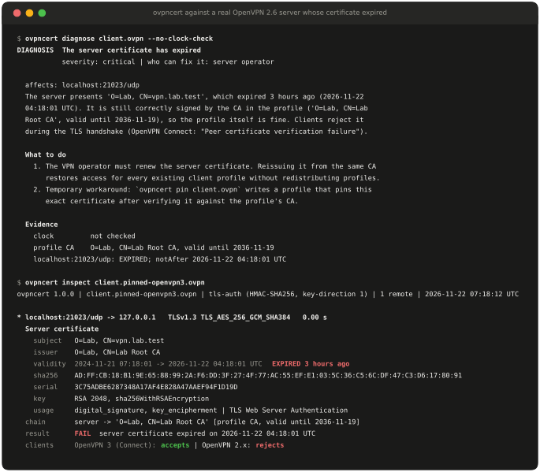

# OpenVPN Certificate Inspector

**Read, verify and monitor the X.509 certificate of an OpenVPN server through a
handshake-only probe.** No credentials are sent. UDP and TCP, `tls-auth` and
`tls-crypt` are supported. The tool is validated against real OpenVPN 2.6 and
OpenVPN 3 clients.



## The problem

OpenVPN carries its TLS handshake inside its own packet format. Servers using
`tls-auth` or `tls-crypt` silently drop anything not authenticated with the
static key from the client profile. Generic TLS tools therefore cannot see an
OpenVPN server's certificate.

When that certificate expires, every client fails with "Peer certificate
verification failure" (OpenVPN Connect) or "certificate verify failed"
(OpenVPN 2.x). Neither message says where the fault lies.

## What `ovpncert` does

| Command | Purpose |
|---|---|
| `ovpncert inspect` | certificate, verified chain, verdict and the acceptance predicted for OpenVPN 3 and OpenVPN 2.x clients, per remote |
| `ovpncert diagnose` | root cause, the party who can fix it, and next steps; NTP clock check and log timeline |
| `ovpncert pin` | a temporary `peer-fingerprint` profile for the right client family, written only for certificates verified against your CA |
| `ovpncert check` | expiry monitoring: Nagios/Icinga exit codes, JSON, Prometheus text format |

```bash
pipx install git+https://github.com/Mhrnqaruni/openvpn-cert-inspector
ovpncert diagnose client.ovpn
```

## Read next

- [Method](method.md): the control-channel protocol, the verification model and the decision tables.
- [Client compatibility](compatibility.md): how OpenVPN 2.6 and OpenVPN 3 treat `peer-fingerprint`, with source references and lab evidence.
- [Results](results.md): unit tests, the real-OpenVPN lab (29/29 and 22/22 cases) and an anonymised field validation.
- [Related work](related-work.md): existing tools, OpenVPN documentation and research.
- [Responsible use](responsible-use.md): when probing and pinning are appropriate.

Source code, issues and releases are on
[GitHub](https://github.com/Mhrnqaruni/openvpn-cert-inspector).
