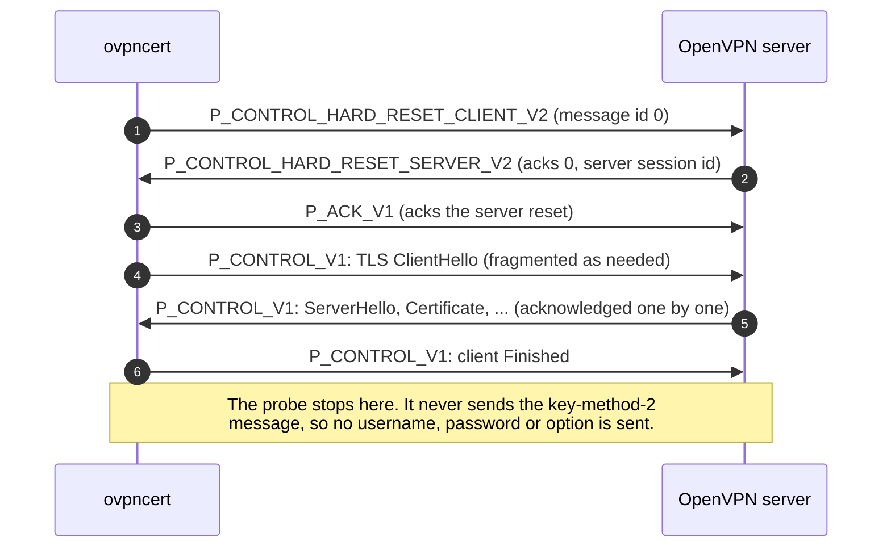

# Method

This document describes how `ovpncert` obtains the certificate of an OpenVPN
server, how it evaluates it, and how the diagnosis, pinning and monitoring
features are derived from that evaluation. File and function names refer to
the package in `src/ovpncert/`.

## 1. Why a dedicated probe is needed

OpenVPN does not expose TLS on the wire. The TLS handshake of the control
channel is carried as payload inside OpenVPN's own packets, which add an
opcode, session identifiers, acknowledgements and a reliability layer. Two
optional protection modes sit in front of that: `tls-auth` adds an HMAC to every
control packet, `tls-crypt` encrypts and authenticates it. A server protected
this way drops any packet that fails the check without answering.

As a result, general-purpose TLS tools (`openssl s_client`, TLS scanners,
certificate-expiry exporters) cannot read the server certificate of an OpenVPN
endpoint. Seeing it requires the client side of the OpenVPN control channel
and, for protected servers, the static key from the client profile.

## 2. Handshake-only session

`handshake.ControlChannelProbe` implements the client side:

* **Session identifiers.** A random 8-byte local session id; the server's id is
  learnt from its hard-reset reply and every later packet must carry it.
* **Reliability layer.** Outgoing reliable packets (`HARD_RESET`, `CONTROL_V1`)
  get increasing message ids and are retransmitted over UDP until acknowledged.
  Incoming control packets are acknowledged (up to 8 ids per packet),
  de-duplicated, and reassembled in message-id order before the payload is
  fed to TLS.
* **Three-way start.** The server's reset is acknowledged with a standalone
  `P_ACK_V1` before the first TLS record. Recent OpenVPN 2.x servers can
  answer the initial reset statelessly, using an HMAC-derived session id as a
  cookie, and create per-client state only when that acknowledgement returns.
  Sending it first works with older and newer servers alike. It was verified
  against OpenVPN 2.6.19 in the lab and against a production deployment.
* **TLS.** Python's `ssl` module runs the handshake over memory BIOs. Records
  are split into 1000-byte control payloads, below OpenVPN's default control
  packet size. Verification is disabled in the TLS layer because it is done
  separately (section 4), with full knowledge of OpenVPN's rules.
* **Certificate capture.** With TLS 1.3 the certificate is encrypted, so it is
  read from the completed client-side handshake (Python 3.13 public API, or
  the equivalent private method on 3.10-3.12). With TLS 1.2 and earlier,
  `tlstap.TlsTap` parses the server's cleartext handshake records in
  parallel. The certificate is therefore captured even when the server aborts
  the handshake later, for example because it requires a client certificate.

Transports (`transport.py`): one OpenVPN packet per UDP datagram; over TCP,
each packet is prefixed with a 16-bit length. An ICMP "port unreachable" on a
connected UDP socket is reported separately from silence.

## 3. Control-channel protection

| Mode | Wire layout after the 9-byte header | Keys taken from the 2048-bit static key |
|---|---|---|
| none | `acks, [peer sid], [msg id], payload` | none |
| `tls-auth` | `HMAC, packet id, time, acks, ...` | HMAC slot of the outgoing / incoming direction, truncated to the `--auth` digest size |
| `tls-crypt` | `packet id, time, tag (32), AES-256-CTR(...)` | client sends with key 1, receives with key 0: 32-byte AES key from the cipher slot, 32-byte HMAC-SHA256 key from the HMAC slot |

Details that matter for interoperability (`wire.py`, `statickey.py`):

* A static key is four 64-byte slots: `key[0].cipher`, `key[0].hmac`,
  `key[1].cipher`, `key[1].hmac`.
* `key-direction 1` (the usual client setting) sends with key 1 and receives
  with key 0, and `0` is the opposite. Without a key direction both
  directions use key 0.
* The `tls-auth` HMAC is computed over `packet id | time | opcode | session id
  | rest`. The replay fields move to the front before hashing, although on
  the wire they follow the HMAC.
* The `tls-crypt` tag is HMAC-SHA256 over the header (opcode, session id,
  packet id, time) and the plaintext. Its first 16 bytes are the initial
  counter block of AES-256-CTR, a synthetic IV.
* Replay protection uses the long form: a 32-bit counter starting at 1 and a
  fixed 32-bit timestamp per session.

A wrong key, key direction or digest makes a protected server silent. The
probe reports it as *no reply* and says so explicitly, because it is
indistinguishable from a filtered port.

## 4. Verification model

`certs.evaluate()` reproduces the two layers of an OpenVPN client:

1. **TLS-library checks**:
   - a signature path from the leaf, through any intermediates the server
     sent, to a CA in the profile;
   - the validity period of every certificate on that path.
2. **OpenVPN policy checks**, all on the leaf:
   - `remote-cert-tls server` (keyUsage present, extendedKeyUsage contains
     serverAuth);
   - `verify-x509-name` (`subject`, `name` or `name-prefix`);
   - `peer-fingerprint` (SHA-256 of the DER certificate).

Signatures are checked with `cryptography`'s
`Certificate.verify_directly_issued_by`, independently of time. "Signed by
the profile CA" and "within its validity period" are therefore separate
findings. That separation is what lets the tool say "expired, but otherwise
genuine".

`certs.predict()` then combines the findings the way each OpenVPN
implementation does. The rules were taken from the source code and confirmed
with real clients in the lab (see [compatibility.md](compatibility.md)):

| Rule | OpenVPN 3 (Connect, openvpn3-linux) | OpenVPN 2.6 |
|---|---|---|
| CA configured, no pin | every TLS-library error is final | every TLS-library error is final |
| CA configured, pin | errors on a CA or intermediate are final; for the leaf, a matching fingerprint replaces the TLS-library verdict | every TLS-library error is still final; the pin is an extra check |
| no CA, pin | the fingerprint decides for the leaf, but "issuer not trusted" errors at depth ≥ 1 (server sends its CA or an intermediate) are final | all TLS-library errors are ignored; the fingerprint decides |
| policy checks | always applied after the override | always applied |

## 5. Diagnosis

`diagnose.diagnose()` turns the evaluation into a root cause and an owner:

| Evidence | Finding | Who can fix it |
|---|---|---|
| leaf `notAfter` in the past, chain otherwise valid | `SERVER_CERT_EXPIRED` | server operator |
| leaf `notBefore` in the future | `SERVER_CERT_NOT_YET_VALID` | server operator |
| CA or intermediate outside its validity period | `CA_EXPIRED` / `ISSUER_INVALID` | server operator |
| no signature path to the profile CA | `CA_MISMATCH` | operator (new profile), or interception |
| `remote-cert-tls` fails | `SERVER_CERT_PURPOSE` | server operator |
| `verify-x509-name` fails | `NAME_MISMATCH` | operator or client |
| pin no longer matches, new certificate valid | `PIN_OUTDATED` | client: return to the original profile |
| certificate invalid at local time but valid at NTP time | `CLIENT_CLOCK` | client |
| no remote answers | `NO_RESPONSE` | network, or wrong static key |
| everything valid | `CERTIFICATE_OK` | none: the failure lies elsewhere |

The clock is measured with one SNTP exchange (RFC 4330), with an HTTPS
`Date` header as fallback. When it is known, certificates are judged at the
corrected time, and a disagreement with the local clock becomes a
`CLIENT_CLOCK` finding. Optionally, an OpenVPN Connect or OpenVPN 2.x log is
parsed (`logs.py`) to find the last successful handshake and the first
certificate failure. The diagnosis checks whether a certificate's `notAfter`
falls between the two.

## 6. Pinning

`pin.pin_profile()` writes a copy of the profile with a `<peer-fingerprint>`
block. It refuses unless every reachable remote passes these gates:

* the certificate is signed by the CA in the profile (otherwise a pin would
  trust an unverified certificate);
* the profile has a CA, so that this could be checked at all;
* `remote-cert-tls` and `verify-x509-name` would still pass;
* for OpenVPN 3 output, no CA in the chain is outside its validity period
  (OpenVPN 3 never overrides those errors).

The output depends on the client family. For `openvpn3` the CA is kept and
the pin is added. For `openvpn2` the CA is removed (fingerprint-only mode),
because OpenVPN 2.6 ignores the pin's override while a CA is configured. The
pinned certificate stops matching as soon as the operator installs a new
one, so the workaround **fails closed**. This happened in the field
validation: the pinned profile stopped connecting the moment the operator
renewed the certificate (see [results.md](results.md)).

## 7. Monitoring

`monitor.check_remote()` uses the earliest `notAfter` on the verified path,
because an expiring CA breaks clients as surely as an expiring server
certificate. An untrusted chain, wrong key usage or a name mismatch is
`CRITICAL` regardless of dates, and a failed probe is `UNKNOWN`. Output
formats:

* **Nagios / Icinga:** one status line with performance data; exit codes
  0/1/2/3.
* **JSON:** for scripts.
* **Prometheus:** text exposition format, for the node_exporter textfile
  collector:
  - `ovpncert_certificate_expiry_timestamp_seconds`
  - `ovpncert_probe_success`
  - `ovpncert_certificate_trusted`
  - `ovpncert_check_state`
