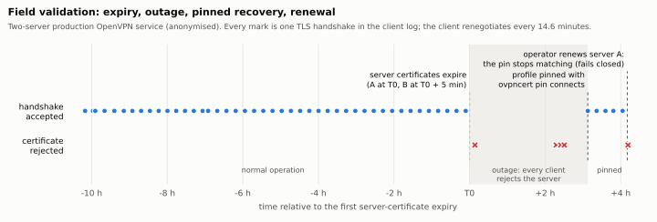

# Results

Three kinds of evidence back the tool:

* unit tests against an in-process control-channel server;
* a lab with real OpenVPN servers and clients, run in CI;
* a field validation on a production OpenVPN service.

## 1. Unit tests

90 tests run in CI on Linux, Windows and macOS with Python 3.10–3.14 (15
jobs), with 89% line and branch coverage. An in-process control-channel server (`tests/fakeserver.py`) exercises
the following:

* the probe over UDP and TCP, with no protection, `tls-auth` and `tls-crypt`;
* TLS 1.2 and TLS 1.3, fragmented records, and servers that demand a client
  certificate (TLS 1.2: certificate read from cleartext records; TLS 1.3:
  from the completed client handshake);
* wrong keys (silence), replies that fail authentication, silent servers and
  closed ports;
* chain evaluation for every certificate state;
* pin generation and its safety gates, monitoring formats, log parsing, the
  clock check against local SNTP and HTTP servers, the diagnosis decision
  table, and the CLI end to end.

## 2. Lab: real OpenVPN servers and clients

`lab/run_lab.py` runs in CI on Ubuntu 24.04. It starts real OpenVPN 2.6.19
servers (OpenSSL 3.0.13) and connects real clients: OpenVPN 2.6.19 and the
OpenVPN 3 core 3.11.3 test client, which is the core inside OpenVPN Connect
3.8. Every CI run repeats it. The latest results are committed in
[`results/`](../results/).

| Group | What is tested | Result |
|---|---|---|
| A. Probe interoperability | UDP/TCP × none, `tls-auth` (HMAC-SHA1/256/512, with and without key direction), `tls-crypt`; wrong key and wrong key direction | 10 / 10 |
| B. Diagnosis | valid, expired, not yet valid, expiring in 5 days, foreign CA, missing serverAuth, intermediate chain, expired CA | 8 / 8 |
| C. Client behaviour, OpenVPN 2.6 | CA only / CA + pin / pin only / wrong pin / `ovpncert pin` output, for servers sending leaf, leaf + root, leaf + intermediate | 11 / 11 |
| C. Client behaviour, OpenVPN 3 | the same scenarios with the OpenVPN 3 client | 11 / 11 |

Group C also records `ovpncert`'s prediction for each client case. **The
prediction matched the real client in all 22 client cases**, including the
two places where the two implementations disagree (see
[compatibility.md](compatibility.md)).

On the loopback interface a probe takes 2–3 ms over UDP and about 40 ms over
TCP. Against the production service below it took 50–90 ms.

Reproduce locally (Linux, or any Docker host):

```bash
docker build -t ovpncert-lab lab/                         # add --build-arg OPENVPN3=1 for the OpenVPN 3 client
docker run --rm --cap-add NET_ADMIN --device /dev/net/tun -v "$PWD:/src" \
    ovpncert-lab python3 /src/lab/run_lab.py --out /src/results --transcripts
```

The transcripts in [`results/transcripts/`](../results/transcripts/) are
unedited CLI output from that run against a real server whose certificate had
expired.

## 3. Field validation (anonymised)

The tool was used during a real outage of a production OpenVPN service. Host
names, addresses, certificate subjects, serial numbers, fingerprints and
absolute times are withheld below. Times are relative to **T0**, the expiry of
the first server certificate.

**Deployment.**

* Two servers (A, B) on UDP 1194.
* `tls-auth` with HMAC-SHA512 and key direction 1; username and password
  authentication.
* TLS 1.3 (AES-256-GCM). RSA-2048 server certificates valid for 731 days,
  from a private CA valid for 20 years.
* Client: OpenVPN Connect 3.8 on Windows, renegotiating every 14.6 minutes.

<picture>
  <source media="(prefers-color-scheme: dark)" srcset="figures/field-timeline-dark.svg">
  
</picture>

| Time | Event |
|---|---|
| T0 − 6 min | last successful renegotiation |
| T0 | server A's certificate expires |
| T0 + 5 min | server B's certificate expires |
| T0 + 9 min | next renegotiation rejected: "Peer certificate verification failure"; every reconnect fails from here on |
| outage | probe: both servers present certificates that expired 731 days after issue and still chain to the profile CA (valid for almost 15 more years); client clock within 1.2 s of NTP; diagnosis `SERVER_CERT_EXPIRED`, owner: server operator |
| T0 + 3 h 08 min | profile written by `ovpncert pin` (OpenVPN 3 variant: CA kept, both certificates pinned) connects; internal hosts reachable over SSH |
| T0 + 3 h 08 min to + 4 h 10 min | renegotiations every 14.6 minutes keep succeeding with the pinned profile |
| T0 + 4 h 10 min | operator issues a new certificate for server A and restarts it |
| T0 + 4 h 12 min | session drops; the reconnect is **rejected by the pin**, which no longer matches: the workaround fails closed |
| T0 + 4 h 13 min | `ovpncert inspect` with the original profile: server A trusted and valid for 731 days; server B still expired |

`ovpncert inspect` with the original profile after the renewal (excerpt,
identifying values replaced):

```text
* <server A>:1194/udp -> 192.0.2.10   TLSv1.3 TLS_AES_256_GCM_SHA384   0.05 s
    validity  <T0 + 4 h 10 min> -> <+731 days> UTC  731 days left
  result      PASS  trusted and within its validity period
  clients     OpenVPN 3 (Connect): accepts | OpenVPN 2.x: accepts
* <server B>:1194/udp -> 192.0.2.11   TLSv1.3 TLS_AES_256_GCM_SHA384   0.09 s
    validity  <T0 - 731 days> -> <T0 + 5 min> UTC  EXPIRED 4.1 hours ago
  result      FAIL  server certificate expired on <T0 + 5 min> UTC
  clients     OpenVPN 3 (Connect): rejects | OpenVPN 2.x: rejects
```

**Observations.**

1. The probe worked on the first attempt against a production deployment
   using `tls-auth` with HMAC-SHA512, a configuration generic TLS tools cannot
   reach.
2. The prediction that OpenVPN Connect accepts a CA + pin profile for an
   expired certificate held in production. So did the opposite: the pin was
   refused as soon as the certificate changed.
3. The operator's fix was the one the diagnosis named: a new certificate from
   the same CA. Unmodified client profiles became valid again.
4. During the operator's maintenance, a burst of four probe runs within about
   a minute went unanswered, and a run two minutes later succeeded. Whether
   that was the restart or rate limiting is not known. Monitoring checks
   should be spaced minutes apart.
